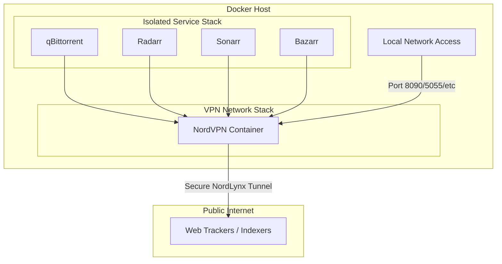

# 🛠️ Automated VPN & Media Stack (GitOps Edition)

This is a production-grade **self-hosted media stack** designed for security, portability, and automation. It utilizes a **NordVPN sidecar** architecture to ensure all traffic is container-isolated and features a fully automated **CI/CD pipeline** via GitHub Actions.

## 🚀 CI/CD & GitOps Workflow

This repository utilizes **GitHub Actions** and a **Self-Hosted Runner** to implement a modern DevOps deployment pipeline:

* **Automated Deployment**: Merges to `main` trigger a push to the production server in **Columbus**.
* **Secure Secret Injection**: The `VPN_TOKEN` is injected at runtime using GitHub Secrets, ensuring no sensitive data is stored in the codebase.
* **Infrastructure Healthchecks**: The pipeline includes a 30-second verification delay and a dynamic container check to ensure the VPN tunnel and core services are active before marking a deployment as successful.

## 🌐 Network Architecture
The following diagram illustrates the **Sidecar VPN** pattern. Only the VPN container has a direct tunnel to the internet, while all other services are network-isolated and route through the encrypted tunnel.

## 🛠️ How to Deploy

### Local Development
1. Clone the repository.
2. Copy `.env.example` to `.env`.
3. Fill in your local `PUID`, `PGID`, and `TZ` values.
4. Use `docker compose up -d`.

### Automated Production Deployment
1. Set up a **GitHub Self-Hosted Runner** on your target server.
2. Add the following **GitHub Secrets** to your repository:
   - `TARGET_HOST`: Your server's IP.
   - `TARGET_USERNAME`: Your SSH username.
   - `TARGET_SSH_KEY`: Your private SSH key.
   - `VPN_TOKEN`: Your NordVPN API token.
3. Push changes to the `main` branch to trigger an automatic deployment.

* **Variable Sanitization**: All local paths and environment-specific IDs are managed via variables, preventing local system leaks in the public repository.

## Services in the Stack:
- **Core Stack:** NordVPN, qBittorrent, Overseerr, Tautulli, Jackett, Radarr, Sonarr, Lidarr, Bazarr, and Flaresolverr.
 

## 🔒 Security Considerations:
- **VPN Usage**: All services are routed through the VPN container, ensuring privacy and security.
- **Port Exposure**: Only necessary ports are exposed. Adjust firewall rules to secure further.
- **Sensitive Data**: Ensure the NordVPN token is kept secure and not publicly exposed.

## ⚖️ Legal Disclaimer:
This setup is intended for personal use and should only be used for downloading and streaming legally acquired content. By using these services, you agree to comply with all applicable laws and regulations. The repository creator is not responsible for any illegal activities or misuse of the system.

